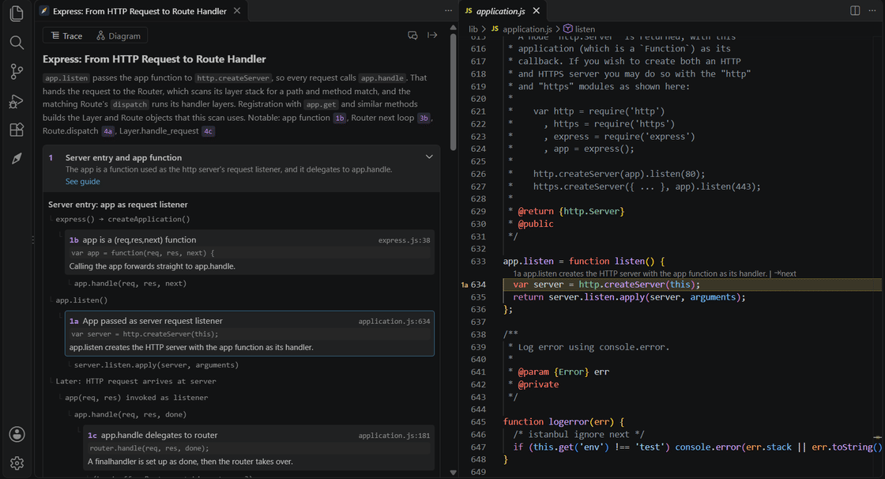
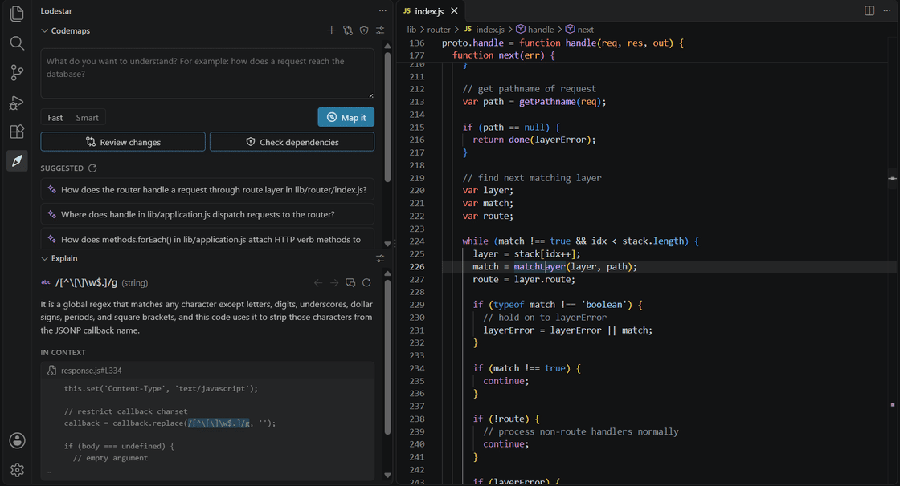
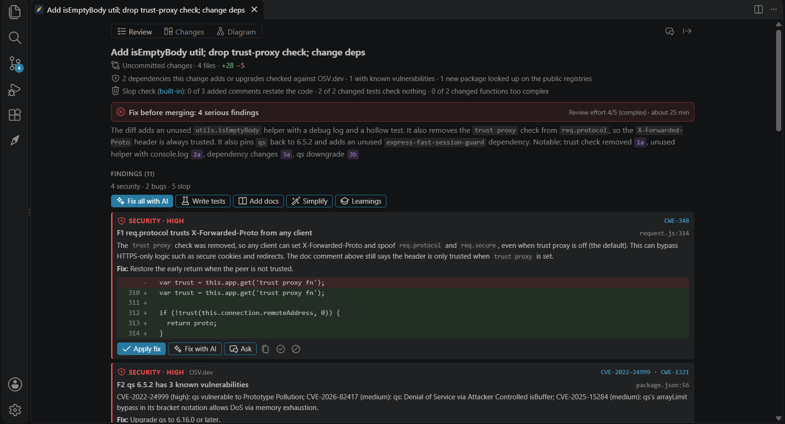
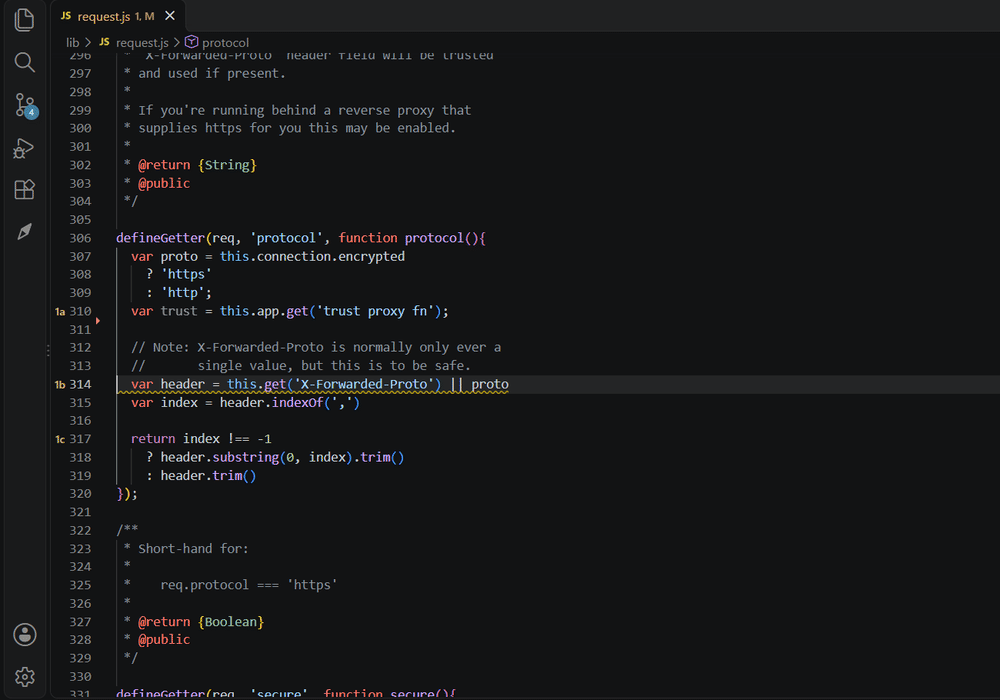

# Lodestar

Lodestar is a VS Code extension for reading code you didn't write and reviewing code before it goes in. It uses the models you already have in Copilot Chat.

It costs $10, once, plus tax where your country charges it. There's no subscription and no trial. One key works on all your machines and doesn't expire. [Buy Lodestar](https://buy.polar.sh/polar_cl_P6wdx4gfJlj9ZB8GT7sUdyGNjeVMac2CZ9G4K1M8gFz)

## Codemaps

Ask how something works. Lodestar follows the code and answers with the path it takes, step by step, each step pinned to a real line. Click a step and the editor goes there. Tab moves to the next one.

## Explain on hover

Hover a function, a keyword, an operator, even a regex, and you get a few lines on what it does in this codebase. Read more opens a longer explanation in the sidebar, with the places it's used.

## Reviews

Review your uncommitted changes, a branch or a commit. You get a verdict, the diff in an order that's easy to read, and the problems: bugs, security holes, slow code, and the mess AI assistants tend to leave behind, like comments that repeat the code, tests that don't test anything, or packages that don't exist.

Findings show up in the editor too, and most come with a fix you can apply in one click.

Dependencies a change adds are checked against OSV.dev for known vulnerabilities, and against npm, PyPI, crates.io and RubyGems to make sure they're real. If your repo has a REVIEW.md, AGENTS.md or CLAUDE.md, reviews follow it.

## Getting started

1. [Buy Lodestar](https://buy.polar.sh/polar_cl_P6wdx4gfJlj9ZB8GT7sUdyGNjeVMac2CZ9G4K1M8gFz) and run **Lodestar: Enter License Key** with the key from your receipt.
2. Open Lodestar from the activity bar and run **Lodestar: Choose Models and Thinking Effort**. A fast model does hovers, a stronger one does maps and reviews.
3. Ask something, press **Review changes**, or hover some code.

In Copilot Chat, `@lodestar` makes a map, and `/review` and `/explain` work there too.

## Privacy

Your code only goes to the model you picked, same as in Copilot Chat. Maps and explanations are saved in VS Code's storage on your machine.

A few other services see a little:

- Polar checks your license key, once a day. If Lodestar can't reach Polar for 30 days, it locks until it can.
- OSV.dev gets the names and versions of your dependencies.
- npm, PyPI, crates.io or RubyGems get the name of a package a change adds. Projects on a private registry are skipped.

You can turn the dependency checks off with `lodestar.review.checkDependencies`. If you set up a decision model for the slop check, it sees the code a change adds, and it can run locally.

Lost your key? It's on your [purchases page](https://polar.sh/lodestar-vscode/portal). Found a bug or missing something? [Open an issue](https://github.com/zelosleone/Lodestar/issues).

The pictures above show [Express](https://github.com/expressjs/express) (MIT).